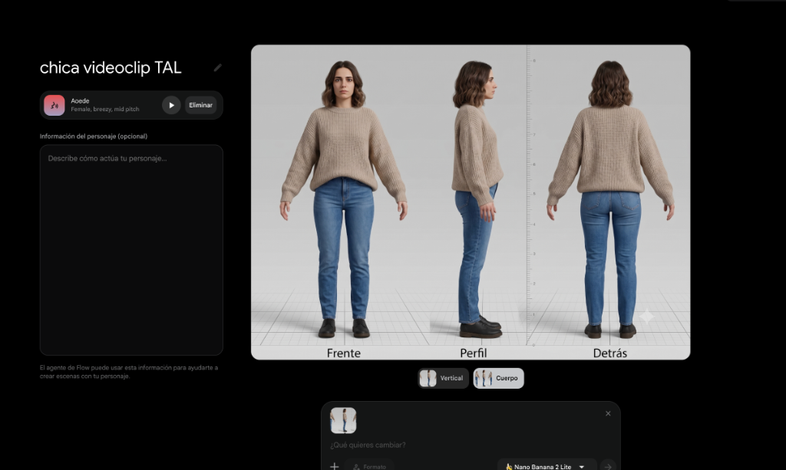
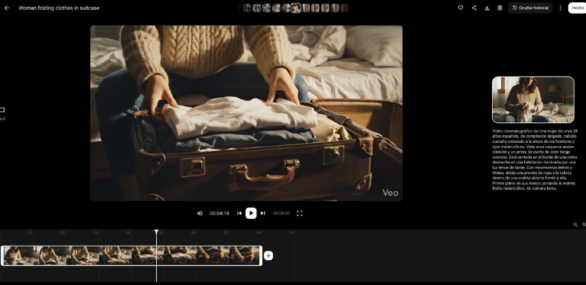
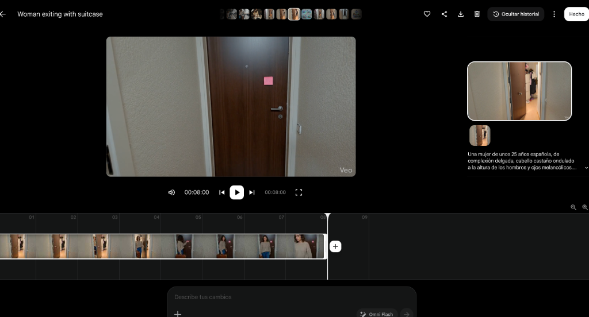
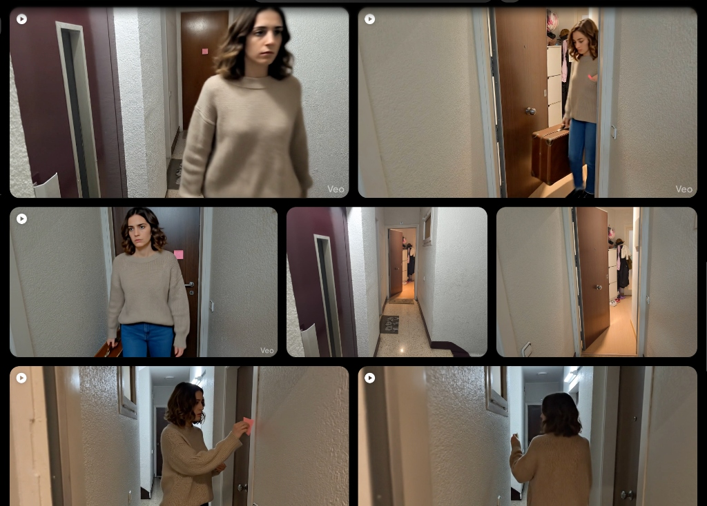

This is what I learned about visual consistency, real references, editing, and how to navigate AI mistakes without letting them derail the project.

## Table of contents

When we started prepping the music video for “Todas aquellas luces” by Los Chicos del Sótano featuring Paraleia, we had a very clear story in mind.

The song is about heartbreak, and we needed several scenes depicting a girl leaving: packing a suitcase, leaving a sticky note before walking out the door, and getting on a train to depart.

The problem wasn't imagining the scenes. It was producing them.

We didn't have a model, nor did we have much time to audition anyone, find locations, and schedule shoot dates. The rest of the music video could be shot by ourselves, but those specific scenes added a small parallel production that risked delaying the entire project.

We decided to try another route: generate only the shots involving the girl using artificial intelligence, and film everything else traditionally.

The idea was not to make a video entirely generated by AI. We wanted to use AI to solve a specific bottleneck during spare moments at home, without relying on multiple people being available at the exact same time.

The result wasn't automatic or flawless. There were impossible doors, floating suitcases, horror-movie-worthy movements, and plenty of discarded attempts. But we also discovered a few tricks that allowed us to wrap up the project and get the AI-generated shots to blend reasonably well with the real ones.

This article isn't meant to be a technical tutorial for a specific tool. It's an explanation of how we used resourcefulness, visual references, and editing to bring to life an idea that otherwise might have been shelved.

## The first problem: the character changed in every shot

We knew we needed a young woman around 35 years old with an everyday look. We didn't want a high-fashion model, but rather someone who felt relatable and believable in a realistic heartbreak story.

To define her, I used ChatGPT like an interviewer. Instead of bluntly prompting "create a girl", we narrowed down the specifics step by step:

- What age she should appear.
- What emotion she needed to convey.
- Whether she should look like a model or an ordinary person.
- What clothing style fit the narrative best.
- Which colors and fabrics should remain consistent.
- How her hair should be styled.
- What camera style we wanted to mimic.
- Which key elements needed to stay identical between scenes.

We ended up defining a natural-looking woman with shoulder-length wavy dark brown hair, a beige knit sweater, blue jeans, and black shoes.

The outfit had to be subtle and believable; her expression reserved and somewhat melancholic. The shots needed to look like they were recorded on an iPhone—both in terms of resolution and color treatment—so they wouldn't clash too hard with our real footage.

The prompt description worked, but a classic issue arose.

The generated woman always looked similar, but never quite identical. They looked like cousin sisters: sharing features, clothes, and style, but subtle variations in face shape or hair were enough to break continuity.

It didn't take massive differences. Our brains detect very quickly when two faces aren't the same person, even if we can't pinpoint exactly what changed.

## Creating a character reference sheet

To solve this, we took the description over to Gemini and generated a character reference sheet for our protagonist:

- Front view.
- Side profile.
- Back view.
- Full outfit.
- Clearly visible hairstyle.
- Consistent proportions.

It was similar to character turnarounds used in 2D/3D animation so different animators always draw the same character accurately.

From that point on, we used both this reference image and a brief text description in every single new generation.

Her face and hair stayed consistent with much higher accuracy. The clothes still varied slightly, but retained their general style, color, fit, and texture reasonably well.

It wasn't 100% perfect continuity, but it was good enough for the edit to be convincing.

That was one of the key takeaways: you don't always need every single detail to be pixel-identical; you just need the core features that viewers recognize as essential to remain stable.

In our case, those key details were primarily her face and hair. If the sweater's knit texture shifted slightly between two quick cuts, nobody noticed. If her face changed, the illusion collapsed immediately.

## Turning the prompt into a reusable template

To avoid starting from scratch for every scene, I built a copy-paste template prompt.

The fixed part included:

- The reference image.
- A concise description of the girl.
- Her outfit and elements that had to remain consistent.
- The realistic visual style.
- The instruction to make it look like smartphone footage.

Then, I only changed three variables:

- The shot type (e.g., close-up, wide shot).
- The location/environment.
- The action.

For instance, the character stayed identical while we shifted from a wide shot to a close-up, from a bedroom to a hallway, or from packing a suitcase to shutting a door.

This workflow cut down repetitive work and, most importantly, prevented accidental rewrites from introducing unwanted changes to key details.

The template didn't guarantee a great video every time, but it gave us a stable starting baseline.

It's a method applicable to many other projects: a recurring pet in social media posts, a brand mascot, a novel protagonist, a fictional product, or a recurring location.

## The real enemy: overly complex physical actions

Maintaining the protagonist's look was only half the battle. The hardest part was getting her to interact naturally with physical objects and space.

The most challenging scene was leaving the apartment.

The protagonist had to open the door, walk out with a suitcase, post a sticky note, turn around, and keep walking. On paper, it didn't sound like an ambitious sequence. For AI video generation, however, it meant coordinating far too many moving parts:

- Body movement.
- Arm placement.
- Carrying a physical suitcase.
- Handling a tiny sticky note.
- Eye direction.
- Turning around.
- Opening and closing a door.
- Spatial and physical interaction between all elements.

The resulting clips had usable moments mixed with completely absurd failures.

The girl would spin around unnaturally or snap her neck. Sometimes she transferred the suitcase from one hand to the other while it hovered in mid-air for a second. Doors opened from one side and closed from another. In one attempt, she walked straight out of a solid wall.

We saw glitchy errors in other scenes as well: a zipper-less suitcase opening out of nowhere, or movements starting naturally only to warp halfway through.

At first, I kept trying to get an entire 8-second generation where everything went right. That led to doing 10+ attempts per shot, and in some cases, even more.

Then I shifted my approach.

Instead of asking if the whole 8-second clip was usable, I started hunting for individual good seconds within each clip.

Maybe the first two seconds were great before the suitcase floated. Maybe the turn worked well, even if the door glitched right after. Sometimes only a single gesture or brief frame was usable.

Through video editing, we could cut right before the glitch and transition quickly to another angle.

This editing style actually matched the pacing of a music video. Fast jump cuts didn't feel like a hack—they felt like intentional editorial choices.

## Using the real world as a reference

The hallway scene posed another dilemma. Generating a random generic corridor wasn't enough.

After stepping out of the apartment, the protagonist needed to walk into an elevator and an environment that visually connected to our real-world shoot location. No matter how detailed the text prompt was, the generated hallways didn't resemble our physical recording spot.

The solution was much simpler than writing longer prompts.

I snapped photos of our real-life hallway, doors, and stairs, and fed them directly as visual references into the AI tool. Then I prompted the scene to use that exact space as its environment.

The result matched our real location far better right from the first try.

This experience made me rethink the role of prompt writing. Sometimes we try to fix every issue by typing longer text prompts, when a single photograph can communicate in seconds what would take paragraphs to explain.

Real-world photo references were especially effective for matching:

- Spatial layout.
- Wall textures and door styles.
- Lighting ambiance.
- Perspective.
- The cohesive feel of belonging to the same building.

The AI didn't have to invent everything from thin air; it just had to work off an existing foundation.

## When text needs to be exact, decouple the process

At the start of the music video, we wanted to display the song title and band names in a creative way rather than using standard overlay typography.

We decided to create a Barcelona-inspired street scene featuring a wall graphic with the text.

The street generated visually well, but AI-generated text was completely unpredictable—garbled letters, misspelled words, or distorted fonts.

Instead of re-generating until the AI magically spelled everything right, we split the task into three phases:

1. Generate the street background image without relying on exact text.
2. Add the clean title and band names accurately using Photopea (or Photoshop).
3. Animate the final composite image afterwards using Google Flow.

The shot retains an admittedly stylized, artificial look. A wall graphic so perfectly placed draws attention and is easily spotted as AI-assisted. But it fulfilled its goal: introducing the song in a far more integrated way than plain text on screen.

The lesson was straightforward: don't force a single tool to handle everything simultaneously.

If a component demands precision—like logos, text, or brand assets—it's usually better to create it in design software and reserve AI for what it does best.

## Video editing mattered more than video generation

Once all the clips were generated, we still had to make them look like they belonged in the same music video.

We had shot real footage on a GoPro Hero 9 Black, an iPhone 16, and a Xiaomi 14T Pro, in addition to the AI-generated clips. Every source had different color profiles, contrast, sharpness, and exposure.

To bridge the gap, we provided frame samples from the different devices and AI generations to Gemini. We asked it to analyze the color differences and guide us on how to match parameters inside DaVinci Resolve.

It gave us a step-by-step color grading guide that I applied in the editor.

Whenever I couldn't locate a specific tool or menu in DaVinci Resolve, I sent screenshots of my screen alongside official documentation excerpts. Gemini acted as a personalized assistant tailored to my exact UI screen.

Editing and visual integration took up the bulk of the project: around 20 hours.

It wasn't my first time using DaVinci Resolve—I had edited the band's previous video, “El camino que hice solo”—but on that project I hadn't used AI generations or AI-assisted learning. Having to figure out the editor entirely on my own back then took nearly twice as long.

This doesn't mean AI edited the video for me. I still had to decide which cuts to use, when to trim, which color adjustments to approve, and how everything fit the rhythm of the track.

What AI did was minimize wasted time navigating menus, searching for functions, or watching irrelevant video tutorials.

It didn't turn out 100% seamless, but the transitions between real devices and AI clips felt cohesive.

## How much work was it really?

In total, I estimate we spent roughly 45 hours on the project:

- Around **20 hours** of video editing and color grading.
- Approximately **12 hours** of real-world filming.
- About **8 hours** generating videos, writing prompts, sketching, and testing.
- Around **5 hours** for storyboarding, concept planning, and band discussions.

AI allowed us to bypass hiring a model and coordinating an extra shoot day, but it didn't turn the project into an instant push-button task.

It shifted the nature of the work.

Instead of spending time traveling, location scouting, and coordinating schedules, we spent it generating, reviewing, discarding, and editing.

About half of the people in our circle who watched the final video didn't notice the girl was AI-generated. Others picked up on it. The graffiti shot, by nature, was more obvious.

Overall, viewers perceived the music video as a home-cooked, low-budget production with thoughtful detail—which was pretty much exactly what we aimed for.

We weren't trying to fake a blockbuster budget. We wanted to finish a meaningful music video within our means.

## How a small coffee shop could apply this workflow

This approach isn't limited to music videos.

Imagine a small local cafe that wants to create a social media reel introducing a seasonal drink, but can't afford actors, professional studio lighting, or a full day of shooting.

They could film all real-life elements using a smartphone:

- The store interior.
- Preparing the drink.
- The finished beverage.
- Interior decor details.
- Staff hands crafting the order.

Then, they could use AI to generate supplementary b-roll shots:

- A customer walking through the front door.
- A brief shot at a cozy window table.
- An outdoor street view with seasonal mood.
- A creative visual transition featuring ingredients.
- A subtle narrative moment around the product.

To keep brand identity intact, they could feed real photos of the cafe into the AI model. To maintain character continuity across shots, they could create a character sheet for the customer actor.

They wouldn't need to generate a full commercial—just bridge the gaps for shots that are tricky or costly to film real.

The key remains curation: knowing what to show authentically and what to represent creatively.

## How an author could use this method

An indie author could apply the exact same system to launch a book trailer or social media teasers without a film crew.

For example, for a romantic novel, they could generate character sheets for the two protagonists defining:

- Appearance and hair.
- Clothing style.
- Key setting aesthetics.
- Visual mood and color palette.
- Overall atmosphere.

With that foundation in place, they could produce:

- Character profile graphics.
- Visual imagery accompanying quote cards.
- Short video clips of train stations, cafes, or cozy apartments.
- An animated scene teaser inspired by a chapter.
- A mood trailer.
- Story posts expanding the world of the novel.

The goal wouldn't be recreating the entire plot frame by frame, but evoking feelings: rain on a window, a suitcase on the floor, two coffee cups on a table, or someone waiting at a platform.

The character sheet ensures the protagonists don't morph between posts, while prompt templates keep the art style unified while swapping locations or actions.

*(Note: Before publishing or using AI content commercially, always review licensing rights, tool terms of service, and guidelines regarding trademarked elements or likenesses.)*

## What I would do differently next time

I wouldn't chase a single perfect 8-second generation through dozens of prompt retries.

I'd generate a few variations, spot the usable seconds, and edit with cuts in mind from the start. I would also break complex actions down into simpler shots: instead of asking one clip to show a girl opening a door, leaving a note, turning around, and carrying a suitcase, I'd split it into multiple straightforward cuts.

I would also look for tools with built-in persistent character features from day one rather than pasting prompts and reference photos repeatedly.

Even so, I'd keep creating reference sheets—they force you to make visual decisions before generating anything.

And I would definitely keep pairing real photo references with generation and editing. That combination was far more effective than trying to solve everything inside a text prompt.

## Tools don't eliminate obstacles, but they stop them from becoming brick walls

AI didn't make the music video for us.

It allowed us to solve very specific roadblocks: not having a model, not being able to organize another shoot day, and needing shots that tied into the song's story.

After that, we had to build references, test, catch glitches, trim good fragments, and log hours in the edit suite.

The value wasn't pressing a button for a finished product. It was combining different tools and adapting our strategy when something failed.

A door that glitches doesn't mean throwing away the scene—it means making a tighter cut or supplying a better reference image.

A character with a changing face doesn't ruin the idea—it means creating a reference sheet and a locked prompt template.

Garbled text doesn't require 20 prompt retries—it means designing it cleanly in Photopea and animating the composite image.

We won't always have the time, budget, crew, or perfect conditions for what we envision. But that doesn't mean the project has to stay trapped in our heads.

Sometimes finishing a project is about accepting constraints, finding a good-enough solution, and combining the tools at hand with a little ingenuity.

At the end of this post, you can watch the final music video for “Todas aquellas luces” by Los Chicos del Sótano featuring Paraleia:

👉 [Watch the music video on YouTube](https://www.youtube.com/watch?v=WobAAo_nGBc)
