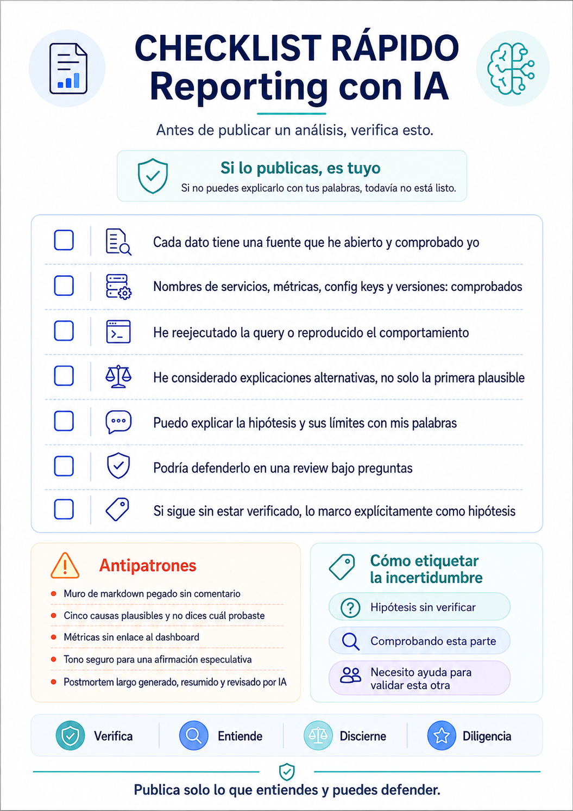

## Table of contents

There is an awkward moment that happens more and more frequently in any engineering team's Slack channels. Though I also see it on Reddit, LinkedIn, Substack...

Someone pastes a three-screen analysis explaining why the checkout failed last night, or why their new agent can make you millions, or how a CFO fixed his life in two afternoons. It is well-written. It has structure, correct terminology, and sounds confident. And then someone asks: _"and where does that number come from?"_.

Silence. Or worse: _"Claude told me"_. Saying "according to Claude" is the ugly relative of "it works on my machine" these days.

That is the problem. It's not that we use AI to investigate an incident — we should, it's one of the things it does best. The problem is publishing something we don't understand, that nobody can verify, and that 48 hours later has quietly turned into the official root cause in the postmortem without anyone having checked it.

I proposed some guidelines for my team about this—things I try to ensure before hitting Ctrl+V.

## The Two Rules That Support Everything Else

**1. If you publish it, you own it.**

Your name on the message means the claim is made by you, not the model. _"The AI says so"_ is not a valid justification in a code review, a postmortem, or a client conversation. It never was for a Stack Overflow copy-paste, and it isn't now.

**2. If you can't explain it in your own words, don't publish it yet.**

This is the operational rule. It's a test you can apply to yourself in ten seconds before hitting send, and it filters out 90% of the problems. If you can't rephrase the conclusion without looking at the output, you haven't understood it: you've just transported it.

Everything that follows is a practical consequence of these two.

As Addy Osmani says: _"Explain it or don't ship it"_.

## Quick AI Reporting Checklist & Downloads

Before publishing any AI-assisted analysis, use this visual checklist:



### Downloadable Team Resources

Download the visual checklist image and Markdown template to attach directly in your Slack channels or internal documentation:

- 📥 [Download Visual Checklist (PNG)](/downloads/si-lo-publicas-es-tuyo-checklist.png)
- 📥 [Download Source Markdown (.md)](/downloads/if-you-publish-it-you-own-it.md)

## 1. Never Paste Raw Output

Pasting a wall of markdown into Slack is not sharing an analysis. It is shifting the review cost onto the reader: now five other people have to read 200 lines to extract the three that matter, and nobody knows which parts you've actually verified.

The format we ask for in any AI-assisted analysis:

```
TL;DR — 1-3 lines, plain language. What is broken, what is the impact.

Hypothesis / Conclusion — in your own words, with confidence level:
  confirmed / probable / speculative

Evidence verified by me — links: Datadog query, log line,
  commit, PR, dashboard. One link per key claim.

Unverified for now — what you have NOT confirmed. Explicit, not implicit.

Next step / Request — what you need, and from whom.

(Optional) Full AI output → in the thread or as a snippet,
  labeled "raw output, unverified".
```

Two details that seem minor but aren't.

The **confidence level** forces an act of honesty that is easy to dodge in prose. Writing _"speculative"_ next to your favorite hypothesis takes effort, and that's why it works.

The **unverified for now** section generates the most resistance and delivers the most value. Nobody wants to write down what they don't know. But an analysis that explicitly declares its gaps is infinitely more useful than one that hides them, because it tells the reader exactly where to help.

Keep the main Slack message under ~15 lines. If you need more, the detailed content belongs elsewhere.

## 2. Format Matters More Than It Seems

If you review everything, add links for the reader to check things, remove all hallucinations... and you still don't provide a summary, we continue putting extra work on the reader, or we lose the attention of those who just need to see what happened—and in situations like a security incident, time is money. The TL;DR always goes in the main Slack message. The detailed analysis goes wherever it renders properly for whoever needs to dive deeper.

**Option A — Attached `.md` file in Slack.**

Save the markdown in a `.md` file and attach it to the message. Slack renders it cleanly: tables, headings, code blocks. Unlike pasting that same markdown into the message box, which flattens tables into an unreadable soup of pipe characters. And no, pasting markdown inside a code block format doesn't solve this.

Less obvious benefits: anyone in the channel can open it without accounts or licenses, and it remains within Slack's retention and access policies. It is a record, not a third-party link.

**Option B — A Claude Artifact, for interactive or long-lived items.**

Works great for dashboards, timelines, comparison tables you plan to iterate on, or a report someone will _navigate_ rather than read once. But you need to know the conditions before choosing this path:

- Creating an artifact requires a paid Claude account.
- Sharing it within the organization means whoever opens it logs in with their corporate account. Only colleagues with licenses can view it. It doesn't work for something the whole channel needs to read.
- The alternative sharing option is a public link: anyone on the internet can open it without authenticating, and published pages can end up indexed by search engines. **Never** use this for incident data, internal architecture, customer data, or anything non-public.
- A link doesn't survive as a record the way a file in the channel does.

**Option C — Slack Canvas or Confluence page.**

For content that becomes a lasting reference: postmortems, runbooks, decision records.

**Rule of thumb:**

| Format                    | Purpose                          |
| ------------------------- | -------------------------------- |
| Slack Message             | TL;DR                            |
| `.md` File                | Detailed analysis                |
| Artifact                  | Interactive content, if required |
| Confluence / Notion / etc | Permanent reference              |

## 3. Verify Before Publishing

Quick checklist. Each item is a "no" until you've genuinely checked it:

☐ Every factual claim traces to a directly verified source, not just to the model's description. (add link if the reader may need it)
☐ Service names, metric names, config keys, file paths, and versions: all real and verified.
☐ The query has been re-run or the behavior reproduced. It has not just been read about, and assistance was requested if needed.
☐ Alternative explanations have been evaluated, beyond the first plausible hypothesis.
☐ The analysis can be defended in a technical review under repeated probing questions.

The first point is the most important, and the easiest to skip without realizing it. Having a model describe the content of a dashboard is not the same as opening the dashboard yourself. The description might be 95% accurate, and that remaining 5% is exactly where the error lives that will cost you two hours of meetings.

And the phrase I repeat most often:

> A well-written answer is not a correct answer. Fluency is not evidence.

Our brains associate clear, well-structured prose with rigor, because historically, writing well was hard and correlated with having thought things through. That correlation is broken. We have to recalibrate manually.

## 4. Feed It Well

Almost all confident-sounding nonsense comes from poor input. Four things that improve output quality far more than any elaborate prompt engineering:

**Give it real data.** Logs, stack traces, diffs, schemas. Not your paraphrase of them. If you describe the error yourself, you are injecting your own hypothesis into the prompt, and the model will happily confirm it back to you.

**Declare constraints.** Stack, versions, environment, what you have already ruled out and why.

**Ask it to highlight uncertainty** and list what it would need to confirm each hypothesis. This gives you your verification checklist for free.

**Ask for counter-hypotheses:** _"what else could produce this same signal?"_. This single question has saved me from going down the wrong rabbit hole more times than any other.

## 5. Traceability

**Label the analysis:** _"AI-assisted analysis, reviewed by \<name\>"_. It costs nothing and aligns reader expectations from line one.

**Under incident pressure:** publishing fast and half-verified is fine — in fact, it's often the right call. But label it explicitly as _"unverified hypothesis, testing now"_ and follow up. What must never happen is an unverified hypothesis silently hardening into the postmortem's root cause.

**Data handling:** approved tools only. No customer data, credentials, or proprietary code outside sanctioned tooling — and watch the sharing format (see Point 2).

## 6. Anti-patterns

We've all seen them. Several of us have committed them.

- ✕ Markdown wall pasted with zero personal commentary.
- ✕ _"The AI thinks it's X"_ without any verification.
- ✕ Five plausible causes with no indication of which ones you tested.
- ✕ Hallucinated metric or service name that nobody catches.
- ✕ AI-generated postmortem that nobody reviewed.
- ✕ Confident tone over a speculative statement.
- ✕ Public artifact link containing internal incident details.
- ✕ Artifact link that key stakeholders cannot open.

## Where This Fits: The 4 Ds

Everything above maps cleanly onto the four pillars of AI literacy:

- **Delegation** — deciding what makes sense to delegate to the model and what doesn't.
- **Description** — providing the right context and artifacts (Point 4).
- **Discernment** — critically evaluating what comes back (Point 3).
- **Diligence** — taking ownership of what you publish, with full traceability (Points 1, 2, and 5).

In my experience, teams master delegation and description quickly because feedback is immediate: if your prompt is bad, the output is bad and you see it right away. Discernment and diligence lack that immediate feedback loop. They fail late — in an incident review or in front of a client — and when they fail, the cost isn't paid by the publisher: it's paid by the team's trust in everything that gets published.

> 💡 **Recommended Resource:** If you want to dive deeper into evaluating real AI capabilities and limitations to train discernment in your team, I recommend taking Anthropic's free course: [AI Capabilities and Limitations](https://anthropic.skilljar.com/ai-capabilities-and-limitations).

## This Isn't Bureaucracy

The predictable objection is that all of this adds friction to something meant to speed us up.

I believe it's the exact opposite. The real cost isn't writing five lines of structure before hitting send: it's three people reading your markdown wall not knowing what to trust, a meeting derailed for twenty minutes by a hallucinated metric name, and a postmortem documenting a cause nobody verified.

Structure is not ceremony. It is the shortest way to tell the reader: _this I've verified, this I haven't, and this is what I need from you._

The final test remains the same: **if you can't explain it in your own words, don't publish it yet.**
