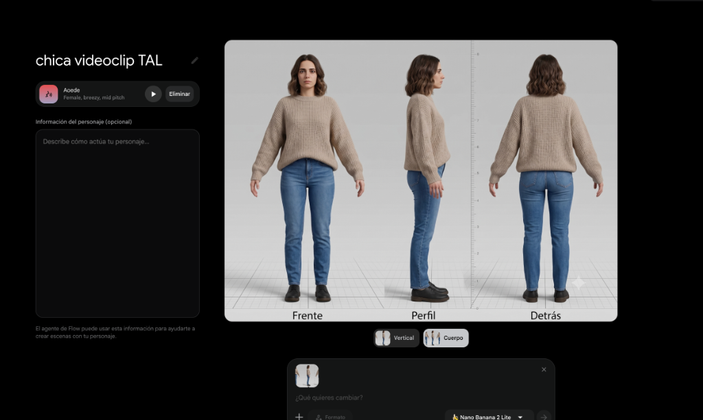
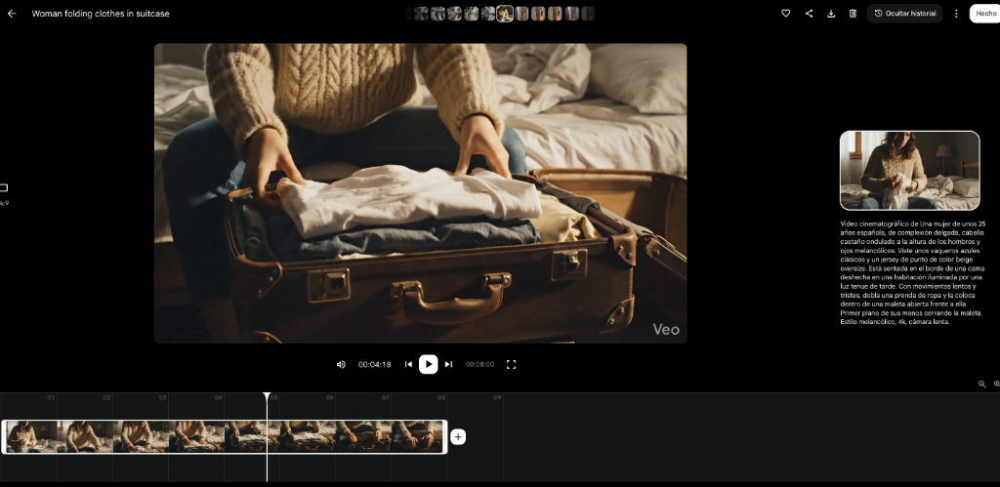
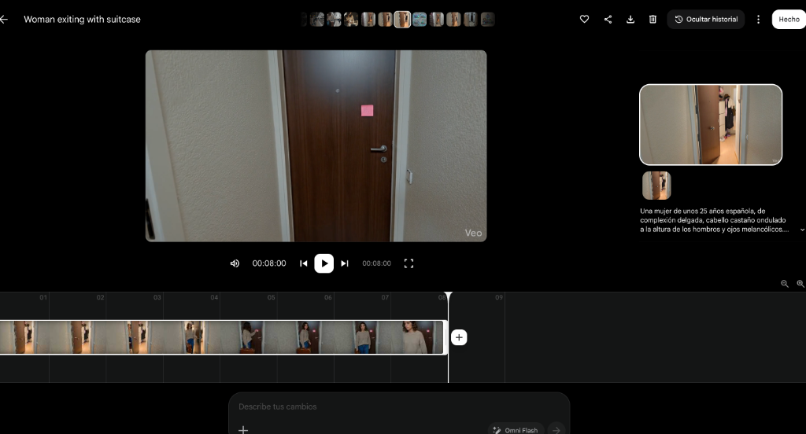
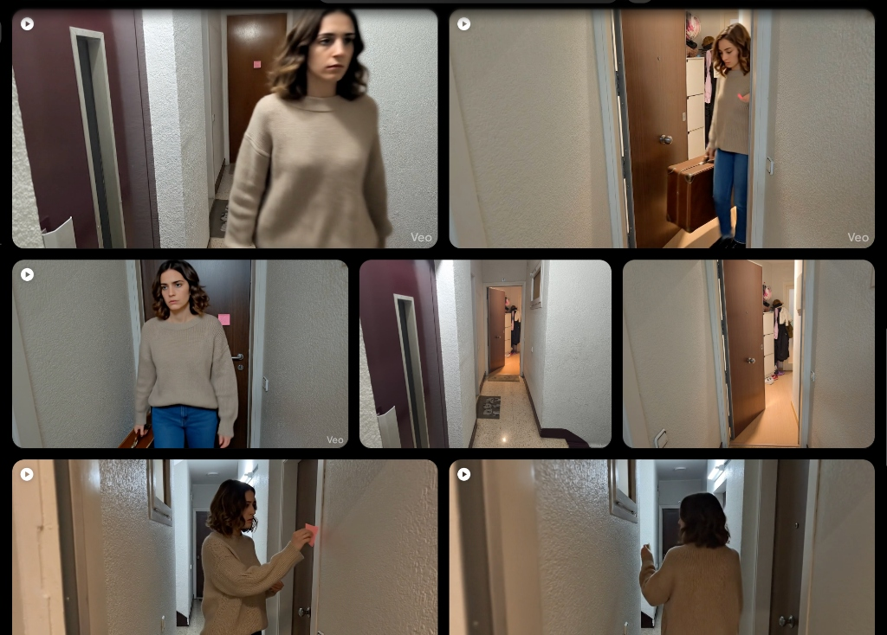

Esto aprendí sobre coherencia visual, referencias reales, edición y cómo sortear los fallos sin que sean un muro para dejar el proyecto a medias.

## Table of contents

Cuando empezamos a preparar el videoclip de “Todas aquellas luces”, de Los Chicos del Sótano en colaboración con Paraleia, teníamos bastante clara la historia que queríamos contar.

La canción habla de desamor y necesitábamos varias escenas que representaran la marcha de una chica: haciendo la maleta, dejando una nota antes de salir de casa y subiendo a un tren para marcharse.

El problema no era imaginar las escenas. Era producirlas.

No teníamos una modelo y tampoco demasiado tiempo para buscarla, encontrar localizaciones y cuadrar horarios de grabación. El resto del videoclip podíamos rodarlo nosotros mismos, pero esas escenas añadían una pequeña producción paralela que podía retrasar todo el proyecto.

Decidimos probar otra vía: generar con inteligencia artificial únicamente las tomas en las que aparecía la chica y grabar de forma tradicional todo lo demás.

La idea no era hacer un videoclip enteramente generado por IA. Queríamos utilizarla para resolver un bloqueo concreto y aprovechar ratos sueltos en casa, sin depender de que varias personas estuvieran disponibles al mismo tiempo.

El resultado no fue automático ni perfecto. Hubo puertas imposibles, maletas flotantes, movimientos dignos de una película de terror y bastantes intentos descartados. Pero también encontramos algunos trucos que nos permitieron terminar el proyecto y conseguir que las escenas generadas encajaran razonablemente bien con las reales.

Este artículo no pretende ser un tutorial técnico sobre una herramienta concreta. Es la explicación de cómo usamos ingenio, referencias visuales y edición para sacar adelante una idea que, de otra manera, quizá habría quedado aparcada.

## El primer problema: la chica cambiaba en cada toma

Sabíamos que necesitábamos una mujer de unos 35 años, joven, moderna y con una apariencia cotidiana. No queríamos una modelo con un estilismo espectacular, sino una persona que pudiera formar parte de una historia realista de desamor.

Para definirla, utilicé ChatGPT como una especie de entrevistador. En lugar de pedir directamente “crea una chica”, fuimos concretando qué necesitábamos:

- Qué edad debía aparentar.
- Qué emoción tenía que transmitir.
- Si debía parecer una modelo o una persona corriente.
- Qué tipo de ropa encajaría con la historia.
- Qué colores y tejidos debían repetirse.
- Cómo llevaría el pelo.
- Qué estilo de cámara queríamos imitar.
- Qué elementos debían mantenerse idénticos entre escenas.

Terminamos definiendo una mujer de apariencia natural, con el pelo castaño oscuro y ondulado a la altura de los hombros, un jersey de punto beige, vaqueros azules y zapatos negros.

La ropa debía ser discreta y creíble. La expresión, contenida y algo melancólica. Las escenas tenían que parecer grabadas con un iPhone, tanto por la calidad como por el tratamiento del color, para que no desentonaran demasiado con las tomas reales.

La descripción funcionaba, pero apareció un problema.

La chica generada siempre era muy parecida, aunque nunca exactamente la misma. Parecían primas hermanas: compartían rasgos, ropa y estilo, pero los pequeños cambios en la forma de la cara o en el pelo eran suficientes para romper la continuidad.

No hacían falta diferencias enormes. Nuestro cerebro detecta muy rápido que dos rostros no corresponden a la misma persona, aunque no sepamos explicar qué ha cambiado.

## Crear una hoja de referencia

Para solucionarlo, pasamos la descripción a Gemini y generamos una hoja de referencia de la protagonista:

- Vista frontal.
- Vista lateral.
- Vista trasera.
- Ropa completa.
- Peinado claramente visible.
- Proporciones consistentes.

Era algo parecido a las fichas que se utilizan en animación para que distintos dibujantes sepan cómo representar siempre al mismo personaje.

A partir de ese momento, utilizamos tanto la imagen como una versión breve de la descripción en cada nueva generación.

La cara y el pelo empezaron a mantenerse con mucha más precisión. La ropa todavía variaba ligeramente, pero conservaba suficientemente bien su estilo, color, talla aparente y tejido.

No era una continuidad perfecta, pero sí lo bastante buena para que el montaje diera el pego.

Ese fue uno de los primeros aprendizajes: no siempre necesitas que todos los detalles sean idénticos; necesitas que los detalles que el espectador reconoce como esenciales permanezcan estables.

En nuestro caso, esos detalles eran principalmente la cara y el pelo. Si el jersey cambiaba un poco de textura entre dos planos rápidos, apenas se notaba. Si cambiaba el rostro, la ilusión desaparecía inmediatamente.

## Convertir el prompt en una plantilla

Para no empezar desde cero en cada escena, preparé una plantilla que podía copiar y pegar.

La parte fija incluía:

- La imagen de referencia.
- Una descripción breve de la chica.
- Su ropa y los elementos que debían mantenerse.
- El estilo visual realista.
- La indicación de que pareciera grabado con un teléfono móvil.

Después solo modificaba tres elementos:

- El tipo de plano.
- El escenario.
- La acción.

Por ejemplo, la protagonista podía permanecer exactamente igual mientras cambiábamos un plano general por un primer plano, una habitación por un pasillo o la acción de preparar la maleta por la de cerrar una puerta.

Este sistema reducía el trabajo repetitivo y, sobre todo, evitaba que una nueva redacción accidentalmente cambiara algún detalle importante.

La plantilla no garantizaba un buen vídeo, pero nos daba un punto de partida estable.

Es un método aplicable a muchas otras situaciones: una mascota que debe aparecer en varias publicaciones, una mascota corporativa, el protagonista de una novela, un producto ficticio o un escenario que debe mantenerse reconocible.

## El verdadero enemigo: las acciones demasiado complejas

Mantener el aspecto de la chica fue solo una parte del problema. Lo más difícil fue conseguir que interactuara de manera natural con los objetos y el espacio.

La escena más complicada era la salida de casa.

La protagonista debía abrir la puerta, salir con una maleta, dejar un post-it, darse la vuelta y continuar caminando. Sobre el papel, no parecía una secuencia especialmente ambiciosa. Para la generación de vídeo, sin embargo, implicaba coordinar demasiadas cosas:

- El movimiento del cuerpo.
- La posición de los brazos.
- La maleta.
- El post-it.
- La dirección de la mirada.
- El giro.
- La apertura y el cierre de la puerta.
- La relación física entre todos esos elementos.

Los resultados tenían partes aprovechables y otras completamente absurdas.

La chica podía girarse de forma brusca o torcer la cabeza de golpe. A veces cambiaba la maleta de una mano a otra mientras esta flotaba durante unos instantes. La puerta se abría por un lado y se cerraba por otro. En algún intento, la protagonista parecía salir directamente de la pared.

También encontramos errores en otras escenas: una maleta que se abría por un lugar en el que no había cremallera o movimientos que comenzaban de forma natural y terminaban deformándose.

Al principio intentaba conseguir una generación completa de ocho segundos en la que todo estuviera bien. Eso me llevó a realizar unos diez intentos por toma y, en algunos casos, bastantes más.

Después cambié el enfoque.

En lugar de preguntarme si el vídeo entero era válido, empecé a buscar qué segundos concretos podía aprovechar.

Quizá los primeros dos segundos eran buenos antes de que la maleta empezara a flotar. Tal vez el giro funcionaba, aunque la puerta fallara justo después. A veces solo servía un gesto o un plano muy breve.

La edición nos permitía cortar antes del error y pasar rápidamente a otra toma.

Esta forma de trabajar encajaba además con el ritmo del videoclip. Los saltos entre planos no parecían únicamente una solución técnica: podían funcionar como una decisión de montaje.

## Utilizar el mundo real como referencia

La escena del pasillo planteaba otro problema. No bastaba con generar un corredor cualquiera.

Después de salir de casa, la protagonista debía aparecer en un ascensor y en un entorno que conectara visualmente con las tomas reales. Por muy detallada que fuera la descripción textual, el escenario generado no se parecía al lugar que habíamos grabado.

La solución fue mucho más sencilla que seguir añadiendo palabras al prompt.

Hice fotografías del pasillo, las puertas y la escalera reales, y las añadí como referencia visual. Después pedí que la escena utilizara aquel espacio como escenario.

El resultado encajó mucho mejor desde el primer intento.

Esta experiencia me hizo replantearme el papel de las descripciones. A veces intentamos resolver cualquier problema escribiendo un prompt más largo, cuando una fotografía puede comunicar en segundos lo que necesitaríamos explicar con varios párrafos.

Las referencias reales fueron especialmente útiles para mantener:

- La distribución del espacio.
- El tipo de paredes y puertas.
- La iluminación.
- La perspectiva.
- La sensación de pertenecer al mismo edificio.

La IA no tuvo que inventar todo. Solo tuvo que trabajar a partir de una base que ya existía.

## Cuando el texto debe ser exacto, es mejor separar el proceso

Al principio del videoclip queríamos presentar el título de la canción y los nombres de los grupos de una forma distinta a los típicos rótulos superpuestos.

Decidimos crear una calle inspirada en Barcelona con un grafiti que incluyera esa información.

La calle funcionaba visualmente, pero el texto generativo era imprevisible. Aparecían letras incorrectas, palabras que no correspondían o nombres deformados.

En vez de insistir hasta que toda la imagen saliera perfecta, dividimos el trabajo en tres fases:

1. Generamos la calle sin depender del texto definitivo.
2. Añadimos el título y los nombres correctamente con Photopea.
3. Animamos después la imagen terminada con Google Flow.

La toma conserva un aspecto evidentemente artificial. El grafiti colocado de forma tan intencionada llama la atención y suele ser una de las escenas que antes se identifican como generadas. Pero cumplía su función: presentar la canción de una manera más integrada que un simple texto sobre el vídeo.

La enseñanza fue sencilla: no conviene pedirle a una sola herramienta que haga todo a la vez.

Si una parte necesita precisión, como un logotipo, una frase o el nombre de una empresa, suele ser mejor crearla con una herramienta de diseño y utilizar la IA únicamente para lo que resuelve bien.

## La edición fue más importante que la generación

Una vez tuvimos todas las tomas, todavía quedaba hacer que parecieran parte del mismo videoclip.

Habíamos grabado con una GoPro Hero 9 Black, un iPhone 16 y un Xiaomi 14T Pro. A eso se sumaban los vídeos generados. Cada fuente tenía diferencias de color, contraste, nitidez y exposición.

Para acercarlas, pasamos ejemplos de los distintos dispositivos y de las tomas generadas a Gemini. Le pedimos que analizara las diferencias y nos indicara cómo aproximar los parámetros dentro de DaVinci Resolve.

Nos proporcionó un paso a paso que fui aplicando en el editor.

Cuando no encontraba una herramienta o una opción concreta, enviaba capturas de pantalla de los menús, acompañadas en ocasiones de la documentación oficial. De esta manera, Gemini funcionaba como una guía adaptada a lo que yo estaba viendo en pantalla.

La edición y la integración visual fueron la parte que más tiempo me llevó: aproximadamente unas veinte horas.

No era mi primer contacto con DaVinci Resolve. Ya había montado el videoclip anterior del grupo, “El camino que hice solo”, pero en aquel proyecto no había utilizado tomas generadas ni asistencia de IA para aprender el programa. Al tener que descubrir por mi cuenta cómo funcionaba el editor, el proceso me llevó aproximadamente el doble.

Esto no significa que la IA editara el videoclip por mí. Seguía teniendo que decidir qué planos utilizar, cuándo cortar, qué ajustes aceptar y qué resultado encajaba con la canción.

Lo que hizo fue reducir el tiempo perdido buscando funciones, interpretando menús y recorriendo tutoriales que no siempre respondían exactamente a mi problema.

No quedó perfecto, pero el cambio entre tomas y dispositivos no era exagerado.

## Cuánto trabajo hubo realmente

En total, calculo que dedicamos unas 45 horas, aunque son cifras aproximadas:

- Unas **20 horas** de edición.
- Aproximadamente **12 horas** de grabación real.
- Cerca de **8 horas** entre generación de vídeos, descripciones, bocetos y pruebas.
- Unas **5 horas** para el storyboard, el planteamiento de ideas y las conversaciones con el grupo.

La IA nos permitió evitar la búsqueda de una modelo y la coordinación de otra jornada de rodaje, pero no convirtió el proyecto en algo inmediato.

Cambió el tipo de trabajo.

En lugar de invertir tiempo en desplazamientos, localizaciones y horarios, lo invertimos en generar, revisar, descartar y editar.

Aproximadamente la mitad de las personas de nuestro entorno que vieron el resultado no detectaron que la chica estaba generada. Otras sí lo notaron. La toma del grafiti, por su propia naturaleza, resulta más evidente.

En general, la gente percibe el videoclip como una producción hecha en casa y con pocos recursos, pero con algunos detalles trabajados. Esa era una valoración bastante cercana a lo que queríamos conseguir.

No pretendíamos simular una superproducción. Queríamos terminar un videoclip coherente con nuestros medios.

## Cómo podría aplicarlo una pequeña cafetería

Este método no tiene por qué limitarse a videoclips.

Imaginemos una cafetería pequeña que quiere crear un reel para presentar una bebida de temporada, pero no puede organizar una sesión con actores, iluminación profesional y varias horas de rodaje.

Podría grabar con el móvil los elementos que necesitan ser reales:

- El establecimiento.
- La preparación de la bebida.
- El producto terminado.
- Los detalles de la decoración.
- Las manos del personal trabajando.

Después podría utilizar IA para crear algunos planos complementarios:

- Una persona entrando en la cafetería.
- Una escena breve en una mesa junto a la ventana.
- Un exterior con un ambiente determinado.
- Una transición visual relacionada con los ingredientes.
- Una pequeña escena narrative alrededor del producto.

Para mantener la identidad del negocio, podría utilizar fotografías reales del local como referencia. Para evitar inconsistencias, podría crear una ficha visual del personaje que aparezca en varios planos.

No sería necesario generar un anuncio entero. Bastaría con cubrir los huecos que resultan difíciles de grabar.

La parte importante seguiría siendo la selección: qué debe mostrarse tal como es y qué puede representarse de una forma más creativa.

## Cómo podría utilizarlo una escritora

Una escritora novel también podría aplicar el mismo sistema para presentar su obra en redes sociales sin tener que rodar un tráiler tradicional.

Por ejemplo, para una novela romántica contemporánea podría crear una hoja de referencia de los dos protagonistas y definir:

- Su apariencia.
- Su ropa.
- Los escenarios principales.
- La atmósfera visual.
- Los colores asociados a la historia.
- La forma en la que deberían aparecer en las publicaciones.

A partir de esa base podría preparar:

- Fichas visuales de personajes.
- Imágenes para acompañar citas.
- Vídeos breves de una estación, una cafetería o un apartamento.
- Una escena animada inspirada en un capítulo.
- Un pequeño tráiler atmosférico.
- Publicaciones que presenten el mundo de la novela sin revelar el argumento.

El objetivo no tendría que ser recrear literalmente toda la historia. Podría utilizar las imágenes para transmitir sensaciones: lluvia en una ventana, una maleta en el suelo, dos tazas sobre una mesa o una persona esperando en un andén.

La hoja de referencia ayudaría a que los protagonistas no cambiaran completamente entre una publicación y otra. La plantilla permitiría mantener el estilo y modificar únicamente el lugar, el plano o la acción.

Antes de publicar o utilizar comercialmente este tipo de contenido, cada persona debería revisar los derechos de uso, las condiciones de las herramientas y cualquier cuestión relacionada con imágenes, marcas o representaciones de personas reales.

## Lo que haría diferente ahora

No volvería a perseguir una toma perfecta durante decenas de intentos.

Generaría unas pocas alternativas, analizaría qué fragmentos funcionan y pensaría desde el principio en cómo montarlos. También dividiría más las acciones complejas: en lugar de pedir que una persona abra la puerta, deje una nota, se gire y salga con una maleta en un único vídeo, intentaría resolverlo mediante varios planos más simples.

Buscaría también desde el principio una función que permitiera guardar y reutilizar un personaje, en lugar de depender siempre de copiar la descripción y adjuntar el boceto.

Aun así, conservaría la hoja de referencia. Es útil incluso cuando la herramienta dispone de sistemas de personajes, porque obliga a tomar decisiones visuales antes de empezar.

Mantendría también la combinación de referencias reales, generación y edición. Fue mucho más eficaz que intentar resolverlo todo dentro de un único prompt.

## Las herramientas no eliminan los problemas, pero pueden evitar que te bloqueen

La IA no hizo el videoclip por nosotros.

Nos permitió resolver algunos obstáculos concretos: no disponer de una modelo, no poder organizar otra grabación y necesitar escenas que conectaran con la historia de la canción.

Después tuvimos que preparar referencias, hacer intentos, detectar errores, recortar los fragmentos útiles y dedicar bastantes horas a la edición.

El valor no estuvo en pulsar un botón y obtener un resultado terminado. Estuvo en combinar herramientas distintas y cambiar de estrategia cuando algo no funcionaba.

Una puerta que se abre mal no tiene por qué obligarte a descartar toda la escena. Puede hacer que necesites otro plano, un corte más rápido o una referencia mejor.

Un personaje que cambia de rostro no tiene por qué acabar con la idea. Puede indicar que necesitas una ficha visual y una descripción fija.

Un texto que aparece mal no tiene por qué generar veinte nuevos intentos. Puedes añadirlo después con una herramienta de diseño.

No siempre tendremos el tiempo, el presupuesto, el equipo o las condiciones ideales para producir lo que imaginamos. Pero eso no significa que la idea tenga que quedarse guardada.

A veces terminar un proyecto consiste precisamente en eso: aceptar las limitaciones, buscar una alternativa suficientemente buena y utilizar con ingenio las herramientas que ya tenemos.

Al final del artículo puedes ver el resultado en el videoclip de “Todas aquellas luces”, de Los Chicos del Sótano, en colaboración con Paraleia:

👉 [Ver videoclip en YouTube](https://www.youtube.com/watch?v=WobAAo_nGBc)

## Lecturas recomendadas

- 📈 [Agentes de IA para Automatización de YouTube](/posts/es/youtube-ai-agent): Descubre cómo automatizamos la estrategia de contenidos de Los Chicos del Sótano multiplicando las visitas x10.
- ⚡ [Sistema de Changelogs con IA](/posts/es/ai-changelog-gem): Creación de Gemas personalizadas en Gemini para estructurar workflows.
- 🚀 [Agentes de IA para Desarrollo](/posts/es/ai-workflow): Mi ecosistema agéntico para acelerar proyectos creativos y técnicos.
