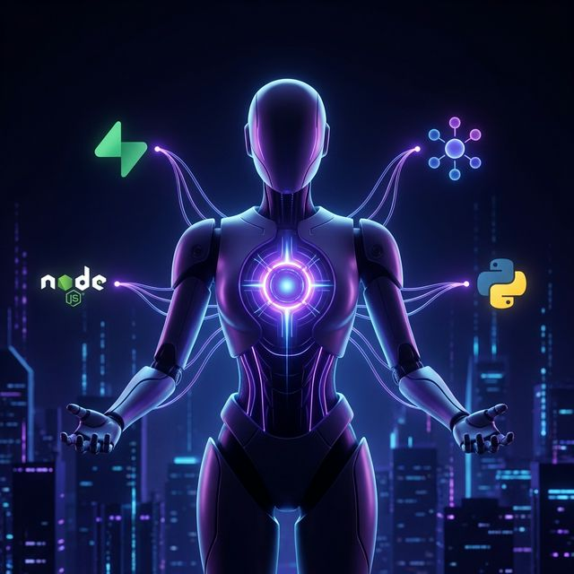

El agente de IA que trabaja por las noches para mi (Jules) ahora soporta MCP, increíble.

Jules es un agente de IA autónomo que te ayuda con tareas de código en tus proyectos. Hablé de él en mi post sobre [**Agentes de IA para Desarrollo**](/posts/es/agentes-ia-desarrollo-meses-a-dias/), donde muestro cómo lo uso para dejarle tareas sencillas durante la noche y revisar por la mañana.

Pero esto se acaba de poner interesante. Desde hace unos días, integra el uso de MCP, conectándose con algunos que uso casi a diario en Antigravity como Supabase, Context7 de Upstash o Stitch.

Esto cambia radicalmente la manera de trabajar. Ya no es solo código aislado, ahora puedes pedirle cosas con contexto real:

- **Supabase:** "Revisa los últimos 50 usuarios registrados que no han verificado su email y genera un script para limpiar esos registros."
- **Stitch:** "Implementa el diseño de la vista 'Homepage' del proyecto 'My habit tracker'." (este particularmente, es uno de esos caso que voy a dejar de hacer con Antigravity para pasarlo a Jules)
- **Context7:** "Configura un Cloudflare Worker script para cachear respuestas de la JSON API por 5 minutos usando Context7."

Ahora es capaz de asumir tareas más complejas. Seguramente en breve implementarán más MCPs, así que, sumado a las cuotas que ofrece, Jules va a pasar largas noches picando código a partir de ahora.

Vamos esos enlaces:

- [Agentes de IA para Desarrollo: Mi flujo de trabajo completo](/posts/es/agentes-ia-desarrollo-meses-a-dias/)
- [Jules MCP](https://lnkd.in/ewiU9YGw)
- [Jules cuotas](https://lnkd.in/eAPatCfk)
- [Supabase MCP](https://lnkd.in/eFhHC6XW)
- [Context7 MCP](https://lnkd.in/eu7h4nh3)

## Lecturas recomendadas

- 🚀 [Agentes de IA para Desarrollo](/posts/es/agentes-ia-desarrollo-meses-a-dias/): Mi ecosistema de orquestación diaria con Gemini, Stitch, Antigravity y Jules.
- 🛠️ [Flujos MCP para Engineering Leads](/posts/es/mcp-claves-lead-productividad/): Cómo uso Datadog, Amplitude y Excalidraw para ahorrar tiempo.
- ⚙️ [5 trucos de Atlassian MCP](/posts/es/5-trucos-atlassian-mcp-para-potenciar-tu-flujo-de-trabajo/): Automatiza la documentación en Confluence y Jira.
