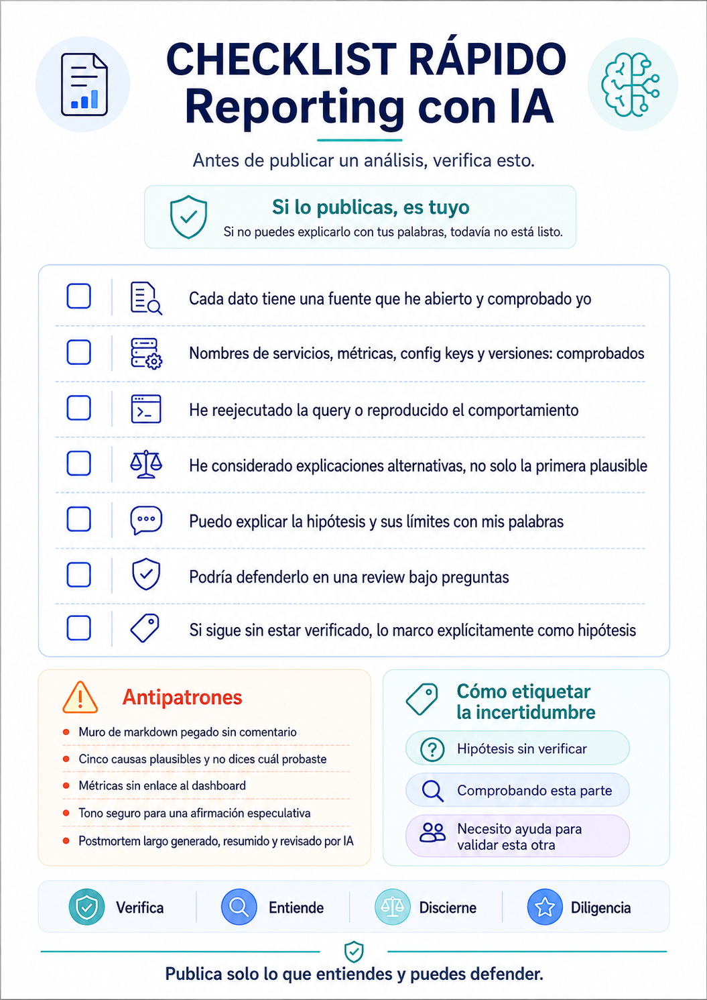

## Table of contents

Hay un momento incómodo que se repite cada vez más en los canales de Slack de cualquier equipo técnico. Aunque también lo veo en Reddit, en LinkedIn, Substack...

Alguien pega un análisis de tres pantallas sobre por qué falló el checkout anoche, o por qué su nuevo agente puede hacerte ganar millones, o cómo ha hecho un CFO en dos tardes que le ha arreglado la vida. Está bien escrito. Tiene estructura, tiene términos correctos, suena seguro. Y entonces otra persona pregunta: _"¿y de dónde sale ese número?"_.

Silencio. O peor: _"me lo ha dicho Claude"_. La de "según Claude" es el pariente feo de "en mi pc funciona" en estos tiempos.

Ese es el problema. No es que usemos IA para investigar un incidente — deberíamos, es una de las cosas en las que mejor funciona. El problema es publicar algo que no entendemos, que nadie puede verificar, y que a las 48 horas se ha convertido en la causa raíz oficial del postmortem sin que nadie lo haya comprobado.

Propuse unas guidelines para mi equipo sobre esto, cosas que yo procuro antes de darle al Ctrl+V.

## Las dos reglas que sostienen todo lo demás

**1. Si lo publicas, es tuyo.**

Tu nombre en el mensaje significa que la afirmación la haces tú, no el modelo. _"Lo dice la IA"_ no es una justificación válida en una code review, ni en un postmortem, ni en una conversación con un cliente. Nunca lo ha sido para un copy-paste de Stack Overflow y no lo es ahora.

**2. Si no lo sabes explicar con tus palabras, todavía no lo publiques.**

Esta es la regla operativa. Es un test que puedes aplicarte en diez segundos antes de darle a enviar, y filtra el 90% de los problemas. Si no puedes reformular la conclusión sin mirar el output, no la has entendido: la has transportado.

Todo lo que viene después son consecuencias prácticas de estas dos.

Como dice Addy Osmani: _"Explícalo o no lo entregues"_.

## Checklist rápido & descargas

Antes de publicar cualquier análisis asistido por IA, utiliza esta checklist visual de verificación rápida:



### Recurso descargable para el equipo

Puedes descargar la versión en imagen y la plantilla en Markdown para adjuntarla directamente en tus canales de Slack o documentación interna:

- 📥 [Descargar Checklist Visual (PNG)](/downloads/si-lo-publicas-es-tuyo-checklist.png)
- 📥 [Descargar Fuente en Markdown (.md)](/downloads/si-lo-publicas-es-tuyo.md)

## 1. Nunca pegues el output en crudo

Un muro de markdown pegado en Slack no es compartir un análisis. Es trasladar el coste de revisión al lector: ahora otras cinco personas tienen que leer 200 líneas para extraer las tres que importan, y ninguna sabe qué partes has comprobado tú.

La forma que pedimos para cualquier análisis asistido por IA:

```
TL;DR — 1-3 líneas, lenguaje llano. Qué está roto, qué impacto tiene.

Hipótesis / conclusión — con tus palabras, y con nivel de confianza:
  confirmada / probable / especulativa

Evidencia que he comprobado yo — links: query de Datadog, línea de log,
  commit, PR, dashboard. Un link por cada afirmación que importe.

Sin verificar todavía — qué NO has confirmado. Explícito, no implícito.

Siguiente paso / petición — qué necesitas, y de quién.

(Opcional) Output completo de la IA → en el hilo o como snippet,
  etiquetado "output crudo, sin verificar".
```

Dos detalles que parecen menores y no lo son.

El **nivel de confianza** obliga a un acto de honestidad que en prosa se puede esquivar. Escribir _"Por confirmar"_ al lado de tu hipótesis favorita cuesta, y por eso funciona.

El apartado de **Por confirmar** es el que más resistencia genera y el que más valor aporta. Si hay varias cosas a comprobar, y dices qué estas mirando tu y qué no has mirado aún, el trabajo se puede repartir y queda claro el estado de cada hipotesis.

Mantén el mensaje principal de Slack por debajo de unas 15 líneas. Si necesitas más, el detalle va en otro sitio.

## 2. El formato importa más de lo que parece

Si revisas todo, pones enlaces para comprobar las cosas por parte del lector, has quitado todas las alucinaciones... y no pones un resumen, seguimos poniendo trabajo extra en el lector, o perdemos la atención de aquellos que solo necesitan ver qué ha pasado, y en situaciones como un incidente de seguridad el tiempo es oro. El TL;DR va siempre en el mensaje de Slack. El detalle va donde se renderice de forma correcta para quien necesite profundizar.

**Opción A — fichero `.md` adjunto en Slack.**

Guardas el markdown en un `.md` y lo adjuntas al mensaje. Slack lo renderiza correctamente: tablas, headings, bloques de código. Al contrario que pegar ese mismo markdown en la caja de texto, que aplasta las tablas en una sopa de pipes ilegible. Y no, pegar markdown aplicando el formato de bloque de código no soluciona esto.

Ventajas menos obvias: lo puede abrir cualquiera del canal, sin cuenta ni licencia de nada, y queda dentro de las políticas de retención y de acceso de Slack. Es un registro, no un enlace.

**Opción B — un artifact de Claude, para cosas interactivas o de vida larga.**

Funciona muy bien para dashboards, timelines, tablas comparativas que vas a iterar, o un informe que alguien va a _navegar_ en lugar de leer una vez. Pero hay que conocer las condiciones antes de tirar por aquí:

- Crear un artifact requiere cuenta de Claude en plan de pago.
- Compartirlo dentro de la organización implica que quien lo abre inicia sesión con su cuenta corporativa. Solo pueden verlo colegas con licencia. No sirve para algo que todo el canal tiene que poder leer.
- La alternativa de compartición es un enlace público: cualquiera en internet lo abre sin identificarse, y las páginas publicadas pueden acabar indexadas por buscadores. **Nunca** para datos de incidentes, arquitectura interna, información de clientes o cualquier cosa que no sea pública.
- Un enlace no sobrevive como registro igual que un fichero en el canal.

**Opción C — canvas de Slack o página de Confluence.**

Para lo que se convierte en referencia duradera: postmortems, runbooks, decision records.

**Formato según se necesita:**

| Soporte                   | Para qué                         |
| ------------------------- | -------------------------------- |
| Mensaje de Slack          | el TL;DR                         |
| Fichero `.md`             | el análisis                      |
| Artifact                  | algo interactivo, si se requiere |
| Confluence / Notion / etc | algo permanente                  |

## 3. Verifica antes de publicar

Checklist rápida. Cada punto es un "no" hasta que lo has mirado de verdad:

☐ Cada afirmación factual traza a una fuente comprobada directamente, no solo a la descripción del modelo. (añadir enlace si el lector puede necesitarlo)
☐ Nombres de servicios, métricas, config keys, rutas de fichero y versiones: todos reales y verificados.
☐ La query ha sido reejecutada o el comportamiento reproducido. No solo se ha leído sobre ello, y se ha pedido ayuda si ha sido necesario.
☐ Se han evaluado explicaciones alternativas, más allá de la primera hipótesis plausible.
☐ El análisis se puede defender en una review técnica ante preguntas consecutivas de profundización.

El punto más importante es el primero, y el más fácil de saltarse sin darte cuenta. Que un modelo te describa el contenido de un dashboard no es lo mismo que abrir el dashboard. La descripción puede ser correcta al 95% y ese 5% es exactamente donde vive el error que te va a costar dos horas de reunión.

Y la frase que más repito de todo esto:

> Una respuesta bien escrita no es una respuesta correcta. La fluidez no es evidencia.

Nuestro cerebro asocia prosa clara y bien estructurada con rigor, porque históricamente escribir bien era caro y correlacionaba con haberlo pensado bien. Esa correlación se ha roto. Hay que recalibrar a mano.

## 4. Aliméntalo bien

Casi todo el "nonsense con tono seguro" nace de un input pobre. Cuatro cosas que cambian la calidad del resultado más que cualquier prompt engineering elaborado:

**Dale los datos de verdad.** Logs, stack traces, el diff, el schema. No tu paráfrasis de ellos. Si le cuentas tú el error, estás introduciendo tu propia hipótesis en el input y el modelo te la va a devolver confirmada.

**Declara las restricciones.** Stack, versiones, entorno, qué has descartado ya y por qué.

**Pídele que marque su incertidumbre** y que liste qué necesitaría para confirmar cada hipótesis. Eso te da la lista de verificación gratis.

**Pide la contra-hipótesis:** _"¿qué otra cosa podría producir esta misma señal?"_. Es la pregunta que más veces me ha ahorrado ir en la dirección equivocada.

## 5. Trazabilidad

**Etiqueta el análisis:** _"análisis asistido por IA, revisado por \<nombre\>"_. Cuesta cero y ajusta las expectativas del lector desde la primera línea.

**Bajo presión de un incidente:** publicar rápido y a medio verificar está bien, es lo correcto incluso. Pero etiquétalo como _"hipótesis sin verificar, comprobando ahora"_ y vuelve a por ello. Lo que nunca puede pasar es que una hipótesis sin verificar se endurezca en silencio hasta convertirse en la causa raíz del postmortem.

**Manejo de datos:** solo herramientas aprobadas. Ni datos de clientes, ni credenciales, ni información propietaria fuera del tooling sancionado — y ojo también con el formato en el que compartes (ver punto 2).

## 6. Antipatrones

Todos los hemos visto. Varios los hemos cometido.

- ✕ Muro de markdown pegado sin ningún comentario propio.
- ✕ _"La IA cree que es X"_ sin ninguna verificación.
- ✕ Cinco causas plausibles y ninguna indicación de cuál has probado.
- ✕ Nombre de métrica o de servicio inventado que nadie detecta.
- ✕ Postmortem generado por IA que nadie revisó.
- ✕ Tono seguro sobre una afirmación especulativa.
- ✕ Enlace público a un artifact con detalle interno de un incidente.
- ✕ Enlace a un artifact que la gente que lo necesita no puede abrir.

## Dónde encaja esto: los 4D

Todo lo anterior se mapea bastante limpiamente sobre los cuatro pilares de AI literacy:

- **Delegación** — decidir qué tiene sentido delegar al modelo y qué no.
- **Descripción** — darle el contexto y los artefactos correctos (punto 4).
- **Discernimiento** — evaluar críticamente lo que devuelve (punto 3).
- **Diligencia** — hacerse responsable de lo que publicas, con trazabilidad (puntos 1, 2 y 5).

Mi experiencia es que los equipos aprenden delegación y descripción muy rápido, porque el feedback es inmediato: si describes mal, el resultado es malo y lo ves. Discernimiento y diligencia no tienen ese bucle de feedback. Fallan tarde, en una incident review o delante de un cliente, y cuando fallan el coste no lo paga quien publicó: lo paga la confianza del equipo en todo lo que se publica.

> 💡 **Recurso recomendado:** Si quieres profundizar en cómo evaluar las capacidades reales y las limitaciones de los modelos de IA para entrenar el discernimiento en tu equipo, te recomiendo hacer el curso gratuito de Anthropic: [AI Capabilities and Limitations](https://anthropic.skilljar.com/ai-capabilities-and-limitations).

## Esto no es burocracia

La objeción previsible es que todo esto añade fricción a algo cuya gracia era ir rápido.

Creo que es lo contrario. El coste real no está en escribir cinco líneas de estructura antes de publicar: está en las tres personas que leen tu muro de markdown sin saber qué fiarse, en la reunión que se va veinte minutos por un nombre de métrica inventado, y en el postmortem que documenta una causa que nadie comprobó.

La estructura no es ceremonia. Es la forma más corta de decirle al lector: _esto lo he comprobado, esto no, y esto es lo que necesito de ti_.

El test final sigue siendo el mismo: **si no lo sabes explicar con tus palabras, todavía no lo publiques.**
