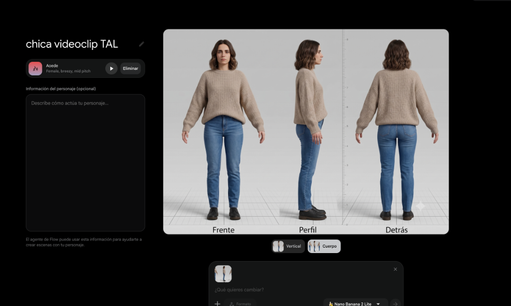
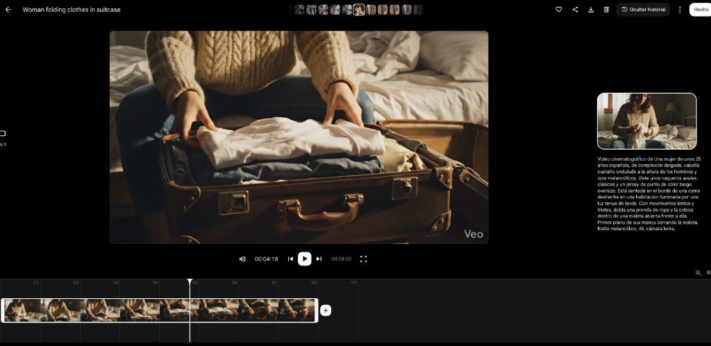
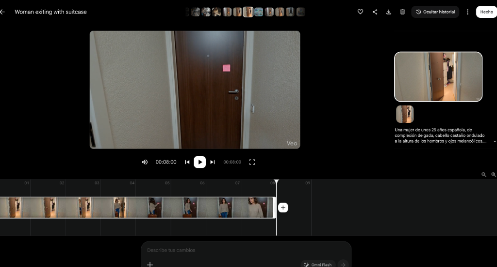
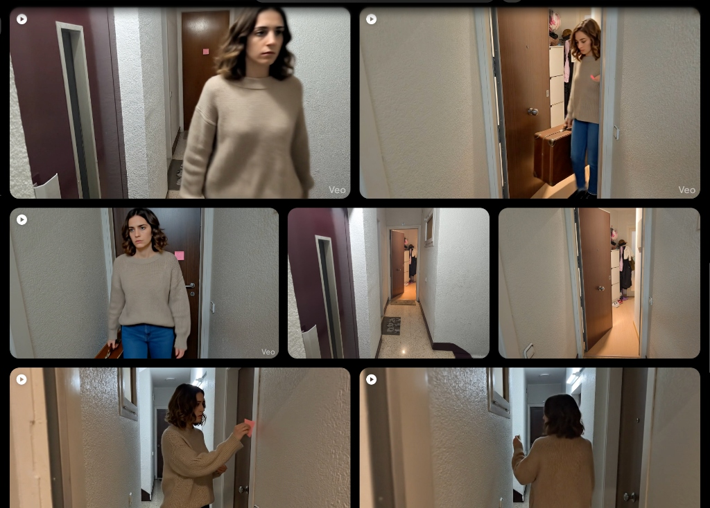

視覚的な一貫性、現実の参照画像、動画編集、そしてAIの生成エラーを乗り越えてプロジェクトを形にするためのノウハウをまとめました。

## Table of contents

Los Chicos del SótanoとParaleiaのコラボ楽曲「Todas aquellas luces」のミュージックビデオ（MV）の制作を始めたとき、表現したいストーリーは明確でした。

楽曲は失恋をテーマにしており、主人公の女性が旅立つシーン（スーツケースに荷物を詰める、家を出る前にメモを残す、電車に乗り込む）が必要でした。

問題はアイデアではなく、それを実際に撮影・制作することでした。

モデルもおらず、モデル探しやロケーション手配、スケジュールの調整に割ける時間も限られていました。他のシーンは自分たちで撮影できても、主人公が登場するカットの撮影は別の並行作業となり、プロジェクト全体が遅延する恐れがありました。

そこで、女性が登場するカットのみをAIで生成し、それ以外のシーンを従来の形式で撮影するというアプローチを試すことにしました。

目的は「完全AI生成のMV」を作ることではありません。特定の制作上のボトルネックを解消し、複数人のスケジュールを合わせることなく自宅の隙行時間で作業を進めるためでした。

結果は一筋縄ではいきませんでした。不自然に動くドア、宙に浮くスーツケース、ホラー映画のような不気味な動き、そして無数の不採用カット。しかし試行錯誤の中で、生成カットと実写カットを違和感なく馴染ませ、プロジェクトを無事に完成させるためのテクニックを見つけることができました。

本記事は特定のツールのチュートリアルではありません。工夫、視覚的参照、そして編集技術を組み合わせて、お蔵入りになりかけたアイデアを完成させたプロセスの記録です。

## 最初の課題：カットごとに主人公の顔が変わってしまう

求めていたのは、35歳前後の親しみやすく自然な雰囲気を持つ若い女性でした。派手なモデル風ではなく、現実感のある失恋ストーリーの主人公にふさわしい人物像です。

人物像を固めるため、ChatGPTをインタビュー相手のように活用しました。「女性を作成して」と直接命じるのではなく、以下のような詳細を一つずつ詰めていきました。

- 外見上の年齢
- 表現すべき感情
- モデルっぽさではなく一般的な人物感
- ストーリーに合う服装のスタイル
- 統一すべき色や素材
- 髪型やスタイリング
- 模倣したいカメラの質感
- シーン間で維持すべき要素

最終的に「肩までのダークブラウンのウェーブヘア、ベージュのニットセーター、ブルーデニム、黒のシューズ」を着用した自然体な女性という定義に辿り着きました。

服装は主張しすぎずリアルに、表情は抑えめで少し切なく。撮影機材の質感を合わせるため、iPhoneで撮影したような画質とカラーバランスを指定しました。

プロンプトによる説明は機能しましたが、ここで問題が発生しました。

生成される女性は毎回似ているものの、完全に同一人物にはなりませんでした。まるで従姉妹のように特徴や服は共通していても、輪郭や髪型の微妙な違いによって同一人物に見えなくなってしまうのです。

人間の脳は、顔のわずかな変化を非常に敏感に察知します。

## キャラクター参照シートの作成

この課題を解決するため、文字説明をGeminiに入力し、主人公の参照シート（三面図）を生成しました。

- 正面図
- 側面図
- 背面図
- 全身の服装
- 髪型がはっきりわかる構造
- 統一されたプロポーション

アニメーション制作で複数の描画担当者が同じキャラクターを描く際に使う「キャラクター設定資料」のようなものです。

これ以降、新しいカットを生成するたびに、この画像と簡潔な説明プロンプトをセットで渡すようにしました。

結果として、顔と髪型の一貫性が飛躍的に向上しました。服装の細かい質感には多少のばらつきが残るものの、全体のスタイルや色味、フィット感は十分に維持されました。

完全に一致していなくても、視聴者に違和感を与えないレベルであれば十分です。

重要な学びを得ました。すべての細部を完璧に揃える必要はなく、視聴者が「同一人物」と認識するための根幹要素（顔と髪型）さえ固定できれば良いのです。セーターの編み目が一瞬変わっても気になりませんが、顔が変われば錯覚は一瞬で崩壊します。

## プロンプトをテンプレート化する

毎シーン一からプロンプトを書く手間を省くため、コピペ可能なテンプレートを作成しました。

固定部分：
- 参照画像
- 主人公の簡潔な説明
- 服装および固定すべき要素
- リアルなビジュアルスタイル
- スマートフォン撮影風の質感指定

可変部分（シーンごとに変更）：
- アングル・構図（引き、アップ等）
- 舞台・背景
- 動作・アクション

これにより、引きの画からアップへ、部屋から廊下へ、スーツケースを詰める動作からドアを閉める動作へと変えても、主人公のビジュアルを維持できるようになりました。

このテンプレート化によって定型作業が減り、記述ミスによって重要設定が失われるのを防ぐことができました。

テンプレートは完璧な動画を保証するものではありませんが、安定したスタートラインを提供してくれます。企業のキャラクター、小説の主人公、商品の架空ビジュアルなど、さまざまな用途に応用できる手法です。

## 本当の敵：複雑すぎる動作の生成

キャラクターの見た目を保つことは課題の半分に過ぎませんでした。最大の難関は、主人公とオブジェクトや空間との相互作用を自然に見せることでした。

最も苦戦したのが「家を出るシーン」です。

「ドアを開け、スーツケースを持って外に出て、メモを残し、振り返って歩き去る」という一連の動作です。文字にするとシンプルですが、AI動画生成にとっては多くの要素を同期させる必要がありました。

- 体の動き
- 腕の位置
- スーツケースの保持
- 付箋（メモ）の設置
- 視線の誘導
- 身体の回転
- ドアの開閉
- 物体間の物理的な関係性

生成された動画には、使える部分と破綻している部分が混在していました。

急に不自然な向きへ首が回転したり、スーツケースが手に浮いたまま移動したり、ドアが異常な開き方をしたり。壁から人間が突き抜けて出てくるような失敗もありました。

最初は、8秒間すべてが完璧な動画が得られるまで何十回もリトライを繰り返していました。

しかし、途中で考え方を切り替えました。

「8秒全体の完成度」を求めるのではなく、「使える数秒間」を探すアプローチに変更したのです。

最初の2秒間は完璧であれば、スーツケースが浮き始める前にカットする。回転する動作が良ければ、その直後の破綻は編集でカットする。

動画編集によって破綻する手前で切れば、MVのリズム感に合わせたテンポの良いカット割りとして成立させることができます。

## 現実の空間をリファレンスとして活用する

廊下のシーンでも問題が発生しました。単に「廊下」とプロンプトに入力するだけでは、実際の撮影ロケーションと繋がらない異質な空間が生成されてしまいました。

解決策はプロンプトを長くすることではなく、現実の写真を渡すことでした。

実際の廊下、ドア、階段の写真を撮影し、AIにリファレンス画像として与えた上でシーンを生成させました。

結果として、初回から実写素材と馴染む背景が生成されました。

長文のテキストで説明するよりも、1枚の画像を見せる方が圧倒的に正確で早いということを実感しました。

現実のリファレンス画像は、以下の要素を揃えるのに極めて有効でした。

- 空間の配置・奥行き
- 壁やドアの質感
- 照明の雰囲気
- パース感
- 同じ建物内であるという統一感

AIにゼロから想像させるのではなく、既存のベースを与えることが成功の鍵でした。

## 文字の正確性が求められる作業は工程を分離する

MVの冒頭で、楽曲タイトルとバンド名をストリートアート風のグラフィティとして表示したいと考えました。

バルセロナ風の街並み画像を生成したものの、AIによるテキスト生成は不確実で、スペルミスや歪んだ文字が頻発しました。

AIにテキストまで完璧に描かせようとするのをやめ、プロセスを3段階に分けました。

1. テキストを含まない街並みの背景画像をAIで生成
2. Photopea（画像編集ソフト）で正確なタイトルとロゴを合成
3. 合成した完成画像をGoogle Flowで動画としてアニメーション化

結果として、非常に違和感のないタイトルカードを制作することができました。

精度の必要な要素（ロゴや文字）はデザインツールで作成し、AIが得意な表現にのみAIを使うという役割分担が重要です。

## 生成よりも編集工程が鍵となった

すべての素材が揃った後、実写素材とAI素材のカラーや質感を統合する作業が必要でした。

GoPro Hero 9 Black、iPhone 16、Xiaomi 14T Proで撮影した実写映像にAI生成動画が加わり、色味やコントラスト、解像感にバラつきがありました。

各デバイスのトーンを合わせるため、Geminiに各素材のフレーム画像を渡し、DaVinci Resolveでのカラー調整パラメーターのアドバイスを求めました。

表示されたステップに従って調整を行い、操作に迷った際はスクリーンショットをGeminiに見せて解決していきました。

編集および視覚的統合には約20時間を費やしました。

AIが自動で編集を行ってくれたわけではありません。カットの選択、タイミング、カラー調整の判断は人間が行う必要があります。しかし、AIのおかげで操作方法を探す無駄な時間を大幅に削減できました。

## 実際の作業時間と内訳

全体で約45時間を費やしました。

- 動画編集・カラー調整：約20時間
- 実写撮影：約12時間
- AI動画生成・検証：約8時間
- 絵コンテ・企画検討：約5時間

AIを使うことでモデル手配や追加撮影の負担は減りましたが、作業量がゼロになるわけではありません。移動や撮影の時間が、生成・選別・編集の時間に置き換わったと言えます。

完成したMVを見た周囲の人の約半数は女性がAI生成であることに気づきませんでした。

超大作を目指すのではなく、手持ちの手段で納得のいく作品を完成させることが目的でした。

## 他の用途への応用例：小さなカフェの場合

この手法はMVだけでなく、店舗のSNS動画などにも応用できます。

例えば、季節限定ドリンクをアピールしたい個人経営のカフェの場合：

実写で撮影する要素（スマホ撮影）：
- 店内の雰囲気
- ドリンクの仕込み作業
- 完成した商品
- インテリアの寄り

AIで補完する要素：
- 入店するお客さんのカット
- 窓際でくつろぐ様子
- 季節感のある屋外イメージ

実店舗の写真や人物設定シートを活用することで、低予算でもクオリティの高いPR動画を制作できます。

## 課題を乗り越えて完成させるために

AIはすべての作業を自動化してくれる魔法ではありません。

しかし、「モデルがいない」「撮影時間が足りない」といった具体的な壁を乗り越える強力なツールになります。

失敗カットを恐れず、良い瞬間を切り取って編集で繋ぐこと。テキストだけでなく画像リファレンスを活用すること。

手持ちのツールと工夫を組み合わせることで、諦めかけていたアイデアを形にすることができます。

記事の最後で、完成したLos Chicos del Sótano × Paraleia「Todas aquellas luces」のミュージックビデオをご覧ください！
