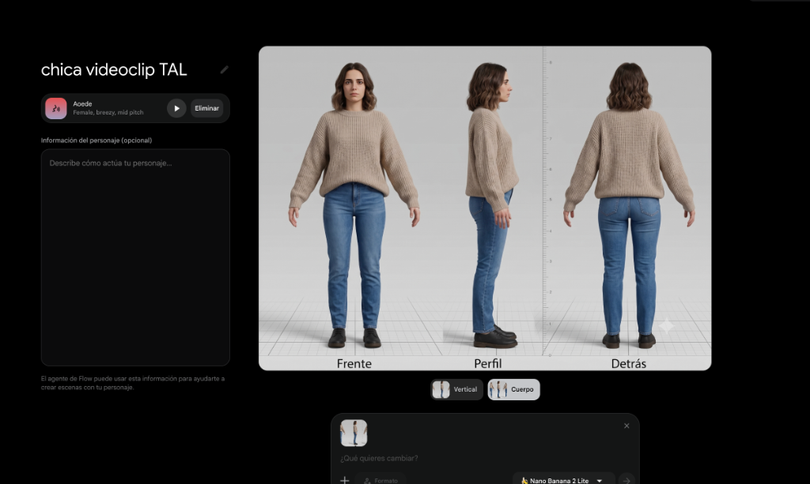
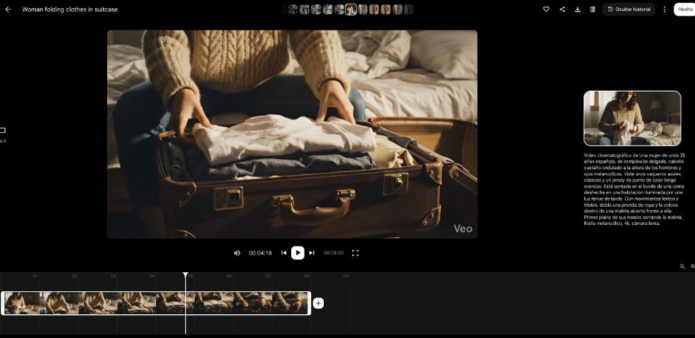
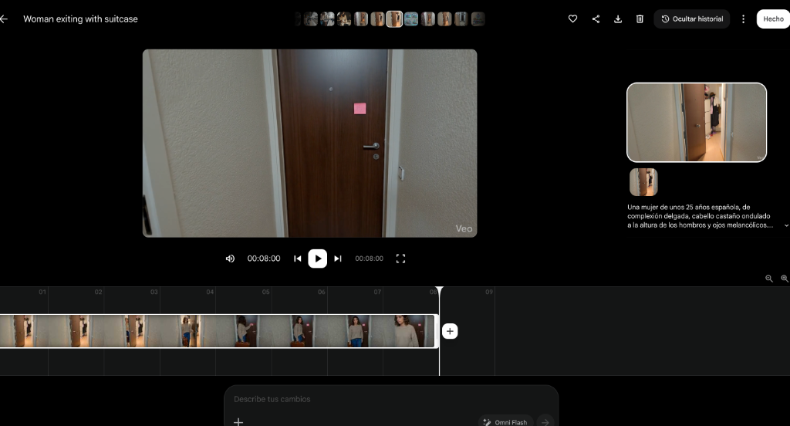
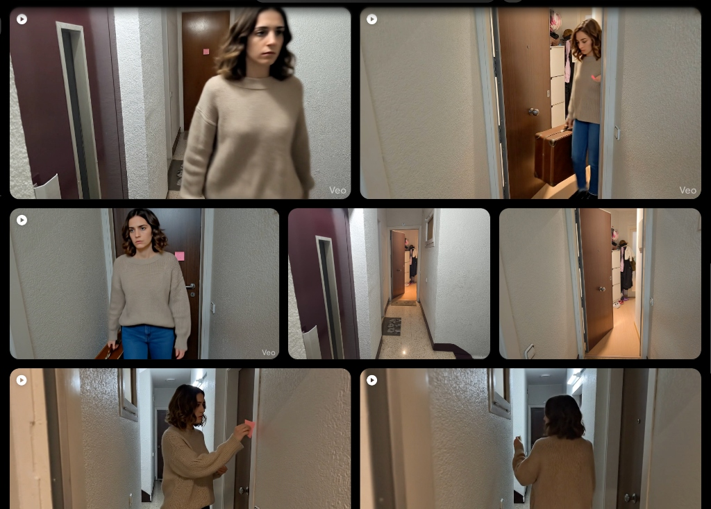

Isto foi o que aprendi sobre coerência visual, referências reais, edição e como contornar as falhas da IA para não deixar o projeto pela metade.

## Table of contents

Quando começamos a preparar o videoclipe de “Todas aquellas luces”, do grupo Los Chicos del Sótano em colaboração com Paraleia, tínhamos uma ideia muito clara da história que queríamos contar.

A música fala de desamor e precisávamos de várias cenas representando a partida de uma garota: fazendo a mala, deixando um bilhete antes de sair de casa e embarcando em um trem para ir embora.

O problema não era imaginar as cenas. Era produzi-las.

Não tínhamos uma modelo e nem muito tempo para buscar uma, encontrar locações e conciliar horários de gravação. O restante do videoclipe poderíamos gravar nós mesmos, mas essas cenas adicionavam uma pequena produção paralela que poderia atrasar todo o projeto.

Decidimos tentar outro caminho: gerar com inteligência artificial apenas as tomadas em que a garota aparecia e gravar de forma tradicional todo o resto.

A ideia não era fazer um videoclipe inteiramente gerado por IA. Queríamos usá-la para resolver um bloqueio pontual e aproveitar momentos livres em casa, sem depender da disponibilidade de várias pessoas ao mesmo tempo.

O resultado não foi automático nem perfeito. Houve portas impossíveis, malas flutuantes, movimentos dignos de um filme de terror e várias tentativas descartadas. Mas também encontramos alguns truques que nos permitiram concluir o projeto e fazer com que as cenas geradas encaixassem razoavelmente bem com as reais.

Este artigo não pretende ser um tutorial técnico sobre uma ferramenta específica. É a explicação de como usamos criatividade, referências visuais e edição para colocar em prática uma ideia que, de outra forma, talvez ficasse engavetada.

## O primeiro problema: a garota mudava em cada tomada

Sabíamos que precisávamos de uma mulher de cerca de 35 anos, jovem, moderna e com uma aparência cotidiana. Não queríamos uma modelo com estilo extravagante, mas alguém que pudesse fazer parte de uma história realista.

Para defini-la, usei o ChatGPT como um entrevistador. Em vez de pedir diretamente "crie uma garota", fomos detalhando o que precisávamos:

- A idade aparente.
- A emoção a ser transmitida.
- Se deveria parecer uma modelo ou uma pessoa comum.
- Que estilo de roupa combinaria com a história.
- As cores e tecidos a serem repetidos.
- Como seria o cabelo.
- O estilo de câmera que queríamos imitar.
- Os elementos que deveriam permanecer idênticos entre as cenas.

Terminamos definindo uma mulher de aparência natural, com cabelo castanho-escuro ondulado na altura dos ombros, suéter de tricô bege, calça jeans azul e sapatos pretos.

A roupa devia ser discreta e crível. A expressão, contida e um tanto melancólica. As cenas deviam parecer gravadas com um iPhone para não destoar das tomadas reais.

A descrição funcionou, mas surgiu um problema.

A garota gerada era sempre parecida, mas nunca exatamente a mesma. Pareciam primas irmãs: compartilhavam traços e roupas, mas pequenas variações no rosto ou cabelo quebravam a continuidade.

Nosso cérebro detecta rapidamente quando dois rostos não pertencem à mesma pessoa.

## Criar uma ficha de referência

Para resolver isso, passamos a descrição para o Gemini e geramos uma ficha de referência da protagonista:

- Vista frontal.
- Vista lateral.
- Vista traseira.
- Roupa completa.
- Penteado claramente visível.
- Proporções consistentes.

Algo semelhante às fichas usadas em animação para que diferentes desenhistas saibam como representar o mesmo personagem.

A partir desse momento, usamos tanto a imagem quanto uma versão breve da descrição em cada nova geração.

O rosto e o cabelo passaram a se manter com muito mais precisão. As roupas ainda variavam levemente, mas conservavam bem o estilo, cor e tecido.

Não era uma continuidade perfeita, mas boa o suficiente para o corte funcionar.

Esse foi um dos principais aprendizados: você nem sempre precisa que todos os detalhes sejam idênticos; precisa que os detalhes essenciais reconhecidos pelo espectador permaneçam estáveis.

## Converter o prompt em um modelo

Para não começar do zero em cada cena, criei um modelo reutilizável de prompt.

A parte fixa incluía:

- A imagem de referência.
- Uma descrição breve da garota.
- Suas roupas e elementos fixos.
- O estilo visual realista.
- A indicação de parecer gravado com celular.

Depois, modificava apenas três elementos:

- O tipo de plano.
- O cenário.
- A ação.

Por exemplo, a protagonista permanecia a mesma enquanto mudávamos de um plano geral para um close-up, de um quarto para o corredor, ou da ação de fazer a mala para a de fechar a porta.

Esse sistema reduziu o trabalho repetitivo e evitou alterações acidentais em detalhes importantes.

## O verdadeiro inimigo: ações muito complexas

Manter o aspecto da garota foi apenas parte do problema. O mais difícil foi fazer com que ela interagisse de forma natural com os objetos e o espaço.

A cena mais complicada foi a saída de casa: abrir a porta, sair com a mala, deixar um post-it, virar-se e caminhar. Para a IA, isso exigia coordenar muitos elementos simultâneos.

Os resultados tinham partes aproveitáveis e outras absurdas (malas flutuantes, giros bruscos).

Em vez de buscar um vídeo de 8 segundos perfeito, comecei a selecionar os segundos específicos que funcionavam em cada tentativa.

A edição permitia cortar antes do erro e passar para outra tomada, o que inclusive combinava com o ritmo dinâmico do videoclipe.

## Usar o mundo real como referência

A cena do corredor exigia um espaço que conectasse com as tomadas reais. A solução foi fotografar o corredor real do prédio e enviar essas fotos como referência visual para a IA.

O resultado encaixou muito melhor desde a primeira tentativa.

Uma foto pode comunicar em segundos o que levaria parágrafos de texto para explicar.

## Quando o texto precisa ser exato, separe o processo

Para o título da música e nomes das bandas em um grafite na rua, a geração de texto da IA se mostrou imprevisível.

Dividimos o processo:

1. Geramos a cena da rua sem texto.
2. Adicionamos o texto exato com o Photopea.
3. Animamos a imagem final com o Google Flow.

Separar as etapas garantiu precisão sem perder a estética desejada.

## A edição foi mais importante que a geração

Gravei com GoPro, iPhone e Xiaomi, além dos vídeos de IA. Para harmonizar as cores e contraste, usei o Gemini para analisar as tomadas e fornecer guias de ajuste para o DaVinci Resolve.

Dediquei cerca de 20 horas à edição e integração visual. A IA não editou por mim, mas reduziu o tempo gasto procurando funções ou tutoriais.

## Quanto trabalho houve realmente?

Estimamos cerca de 45 horas no total:

- **20h** de edição e colorimetria.
- **12h** de gravação real.
- **8h** entre geração de vídeos, prompts e testes.
- **5h** de storyboard e planejamento.

A IA nos permitiu viabilizar o projeto sem modelo ou diárias extras de gravação, mudando a natureza do trabalho para curadoria e edição.

## Aplicações para pequenos negócios e autores

Uma pequena cafeteria pode gravar o espaço e preparo real dos produtos com celular e gerar tomadas complementares com IA (clientes entrando, transições criativas).

Uma escritora pode criar fichas de personagens e cenários para produzir teasers visuais do seu livro sem necessidade de equipe de filmagem.

## Conclusão

A IA não fez o videoclipe por nós, mas eliminou bloqueios que poderiam ter deixado a ideia na gaveta.

Finalizar um projeto é aceitar as limitações e usar as ferramentas disponíveis com inteligência e criatividade.

Ao final deste post, você pode conferir o resultado no videoclipe de “Todas aquelas luces”, de Los Chicos del Sótano em colaboração com Paraleia:

👉 [Assistir ao videoclipe no YouTube](https://www.youtube.com/watch?v=WobAAo_nGBc)
